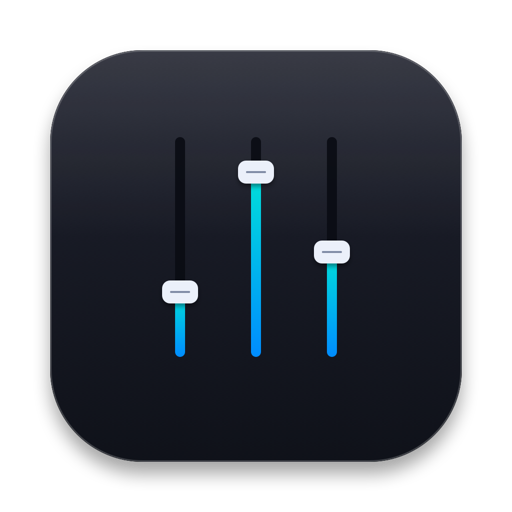
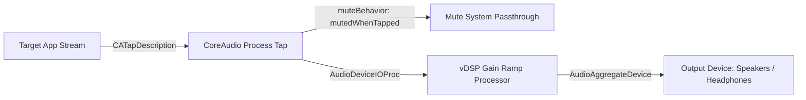

<div align="center">



# Volume Mixer for macOS

**A modern, lightweight per-app volume mixer for macOS menu bar.**  
Control app volumes independently, route audio to different outputs, and mute with zero latency — without any third-party drivers or kernel extensions.

[-black?style=for-the-badge&logo=apple)](https://www.apple.com/macos/)
[](https://swift.org)
[](https://www.apple.com)
[](LICENSE)

<br>

[Русская версия](README_RU.md) • [Download VolumeMixer.dmg](VolumeMixer.dmg) • [Features](#-features) • [Installation](#-installation) • [Architecture](#-how-it-works) • [Building](#-building-from-source)

</div>

---

## ⚡ Features

- 🎚️ **Per-App Volume Control** — Adjust the volume of individual applications (browsers, music players, games, messaging apps) independently of the main system volume.
- 🔇 **One-Click Muting** — Quick mute toggle for each specific application, plus a total mute button for all running apps.
- 🎧 **Per-App Audio Routing** — Direct individual app streams to specific hardware (e.g. route Discord/Telegram to your headset while Spotify plays on external speakers).
- 🪶 **No Virtual Audio Drivers** — Powered natively by macOS 14.2+ CoreAudio Process Tap HAL API (`CATapDescription`). No Soundflower, BlackHole, or Audio Server plugins required.
- ⚡ **Zero-Latency DSP** — Smooth gain adjustments powered by Apple Accelerate (`vDSP`) SIMD instructions with gain ramping to eliminate clicks and distortion.
- 🔋 **Zero Idle CPU Usage** — Passthrough optimization completely stops background tapping when apps are at default volume and output.
- 🎨 **Native Design** — Compact Menu Bar popover adhering to macOS Human Interface Guidelines, dynamic app list resizing, and peak VU meter monitoring.

---

## 📥 Installation

### Requirements
- **macOS 14.2 (Sonoma)** or later (including **macOS 15 Sequoia**)
- Apple Silicon (M1/M2/M3/M4) or Intel Mac

### Quick Install (.dmg)
1. Download or open **[`VolumeMixer.dmg`](VolumeMixer.dmg)** included directly in the repository.
2. Drag **Volume Mixer** into your **Applications** folder.
3. Launch `Volume Mixer.app`. It will appear as a speaker icon in your macOS menu bar.

> [!IMPORTANT]
> **System Permission Note:**  
> On your first volume adjustment, macOS will prompt for **"System Audio Recording"** permission.  
> This is Apple's standard security requirement for CoreAudio process taps so apps can read and adjust process audio streams.  
> *Volume Mixer does not access your microphone, record conversations, or save audio files to disk.*  
> You can verify this anytime in **System Settings → Privacy & Security → Screen & System Audio Recording**.

---

## 🚀 Launch at Login

To start Volume Mixer automatically when you log into your Mac:
1. Open **System Settings** → **General** → **Login Items**.
2. Click **`+`** under **Open at Login**.
3. Select **Volume Mixer** from your `/Applications` folder.

---

## 🧠 How It Works

Traditional macOS volume mixers relied on virtual audio loopback drivers or audio server plugins (`AudioServerPlugIn`), which often broke with OS updates, introduced audio lag, or required disabling SIP.

Volume Mixer uses the **CoreAudio HAL Process Tap API**:



1. **Target Tap**: CoreAudio isolates audio buffers of the target PID and its helper processes (such as `Google Chrome Helper` or Electron renderers).
2. **Original Muting**: With `muteBehavior = .mutedWhenTapped`, CoreAudio suppresses the unattenuated hardware feed.
3. **Hardware Aggregate**: A lightweight private aggregate device processes incoming interleaved Float32 audio frames via `GainRampProcessor`.
4. **Smooth Gain Ramp**: Gains transition smoothly across sample buffers via `vDSP_vsmul` and ramp interpolation to prevent popping artifacts.

---

## 🔨 Building from Source

### Prerequisites
- macOS 14.2+
- Xcode 15.0+ or command-line developer tools

```bash
# 1. Clone repository
git clone https://github.com/your-username/volume-mixer.git
cd volume-mixer

# 2. Build Release application
xcodebuild -project volume-mixer.xcodeproj \
           -scheme volume-mixer \
           -configuration Release \
           -destination 'platform=macOS,arch=arm64' \
           build
```

---

## 🤝 Contributing

Contributions, bug reports, and feature suggestions are welcome!
1. Fork the Project
2. Create your Feature Branch (`git checkout -b feature/AmazingFeature`)
3. Commit your Changes (`git commit -m 'Add some AmazingFeature'`)
4. Push to the Branch (`git push origin feature/AmazingFeature`)
5. Open a Pull Request

---

## 📄 License

Distributed under the **MIT License**. See [`LICENSE`](LICENSE) for more information.
