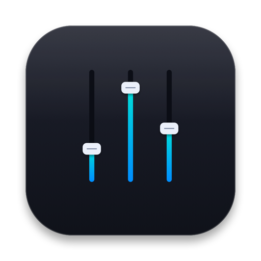
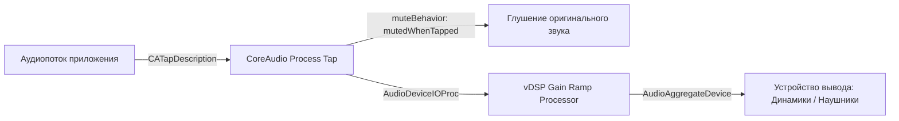

<div align="center">



# Volume Mixer для macOS

**Современный и легковесный микшер громкости отдельных приложений для строки меню macOS.**  
Управляйте громкостью приложений независимо, перенаправляйте звук на разные устройства вывода и отключайте звук с нулевой задержкой — без сторонних драйверов и расширений ядра.

[-black?style=for-the-badge&logo=apple)](https://www.apple.com/macos/)
[](https://swift.org)
[](https://www.apple.com)
[](LICENSE)

<br>

[English](README.md) • [Скачать VolumeMixer.dmg](VolumeMixer.dmg) • [Возможности](#-возможности) • [Установка](#-установка) • [Как это работает](#-как-это-работает) • [Сборка](#-сборка-из-исходного-кода)

</div>

---

## ⚡ Возможности

- 🎚️ **Поканальная регулировка громкости (Per-App)** — изменяйте громкость каждого приложения (браузеров, мессенджеров, медиаплееров, игр) отдельно от общей системной громкости.
- 🔇 **Отключение звука в один клик** — мгновенный Mute для конкретного приложения, а также кнопка общего отключения звука всех запущенных программ.
- 🎧 **Индивидуальный выбор аудиовыхода** — направляйте звук конкретных приложений на нужные устройства (например, Discord/Telegram в гарнитуру, а музыку из Spotify — в колонки).
- 🪶 **Без виртуальных аудиодрайверов** — использует официальный CoreAudio Process Tap HAL API (`CATapDescription`), встроенный в macOS 14.2+. Никаких KEXT-расширений, Soundflower или BlackHole.
- ⚡ **Нулевая задержка и чистый звук** — быстрая обработка сигналов на базе Apple Accelerate (`vDSP`) с алгоритмом плавного нарастания громкости (*Gain Ramping*), предотвращающим щелчки и искажения.
- 🔋 **Нулевая нагрузка в режиме ожидания** — перехватчик звука автоматически отключается (passthrough), когда громкость приложения установлена на 100% и вывод не перенаправлен.
- 🎨 **Нативный интерфейс** — аккуратное меню в Menu Bar по гайдлайнам Apple Human Interface Guidelines, динамическая адаптация высоты под список запущенных приложений и пиковый индикатор уровня (VU-метр).

---

## 📥 Установка

### Системные требования
- **macOS 14.2 (Sonoma)** или новее (включая **macOS 15 Sequoia**)
- Mac на базе Apple Silicon (M1/M2/M3/M4) или Intel

### Быстрая установка (.dmg)
1. Скачайте или откройте готовый файл **[`VolumeMixer.dmg`](VolumeMixer.dmg)** прямо из репозитория.
2. Перетащите иконку **Volume Mixer** в папку **«Программы» (Applications)**.
3. Запустите приложение. В строке меню macOS появится иконка динамика.

> [!IMPORTANT]
> **Разрешение системы:**  
> При первой попытке изменить громкость любого приложения macOS запросит разрешение на **«Запись системного аудио»** (*System Audio Recording*).  
> Это официальное требование Apple для CoreAudio Process Tap, необходимое приложению исключительно для считывания и изменения громкости аудиопотоков.  
> *Volume Mixer не имеет доступа к микрофону, не прослушивает разговоры и не сохраняет аудиофайлы на диск.*  
> Проверить и изменить статус разрешения можно в: **Системные настройки → Конфиденциальность и безопасность → Запись экрана и системного аудио**.

---

## 🚀 Автозапуск при старте системы

Чтобы Volume Mixer запускался автоматически при входе в систему:
1. Откройте **Системные настройки** → **Основные** → **Объекты входа** (*Login Items*).
2. Нажмите **`+`** в списке **«Открывать при входе»**.
3. Выберите **Volume Mixer** из папки «Программы».

---

## 🧠 Как это работает

Традиционные утилиты для управления звуком на macOS использовали виртуальные аудиодрайверы (`AudioServerPlugIn`) или петлевые устройства (loopback), которые часто переставали работать после обновлений системы, вносили ощутимую задержку или требовали отключения защиты SIP.

Volume Mixer построен на современном API **CoreAudio HAL Process Tap**:



1. **Таргетированный тап**: CoreAudio изолирует аудиопотоки целевого PID и всех его вспомогательных процессов (например, `Google Chrome Helper` или процессы рендеринга Electron).
2. **Изоляция оригинала**: С флагом `muteBehavior = .mutedWhenTapped` CoreAudio предотвращает прямое воспроизведение необработанного звука на устройство по умолчанию.
3. **Агрегатное устройство**: Приватное агрегатное устройство обрабатывает поступающие чередующиеся сэмплы Float32 через высокопроизводительный `GainRampProcessor`.
4. **Плавное изменение усиления**: Коэффициент усиления интерполируется векторными инструкциями `vDSP_vsmul` между буферами сэмплов, полностью исключая клики и артефакты.

---

## 🔨 Сборка из исходного кода

### Необходимые инструменты
- macOS 14.2+
- Xcode 15.0+ или установленный пакет Command Line Tools

```bash
# 1. Клонируйте репозиторий
git clone https://github.com/your-username/volume-mixer.git
cd volume-mixer

# 2. Соберите Release-версию приложения
xcodebuild -project volume-mixer.xcodeproj \
           -scheme volume-mixer \
           -configuration Release \
           -destination 'platform=macOS,arch=arm64' \
           build
```

---

## 🤝 Участие в разработке (Contributing)

Мы рады вашим pull-реквестам, сообщениям об ошибках и идеям!
1. Сделайте Fork репозитория
2. Создайте ветку под функционал (`git checkout -b feature/AmazingFeature`)
3. Зафиксируйте изменения (`git commit -m 'Add some AmazingFeature'`)
4. Отправьте ветку в свой репозиторий (`git push origin feature/AmazingFeature`)
5. Создайте Pull Request

---

## 📄 Лицензия

Проект распространяется под открытой лицензией **MIT License**. Подробнее см. в файле [`LICENSE`](LICENSE).
